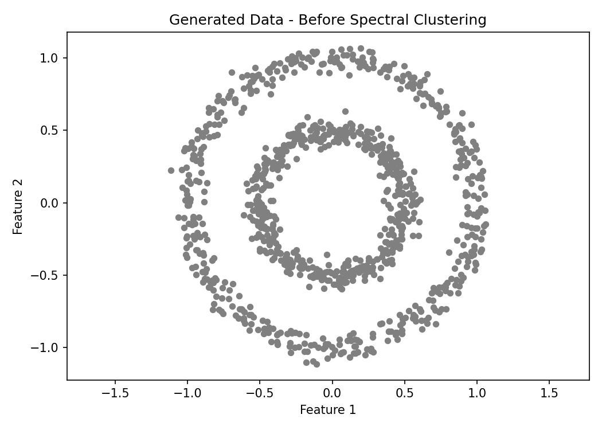
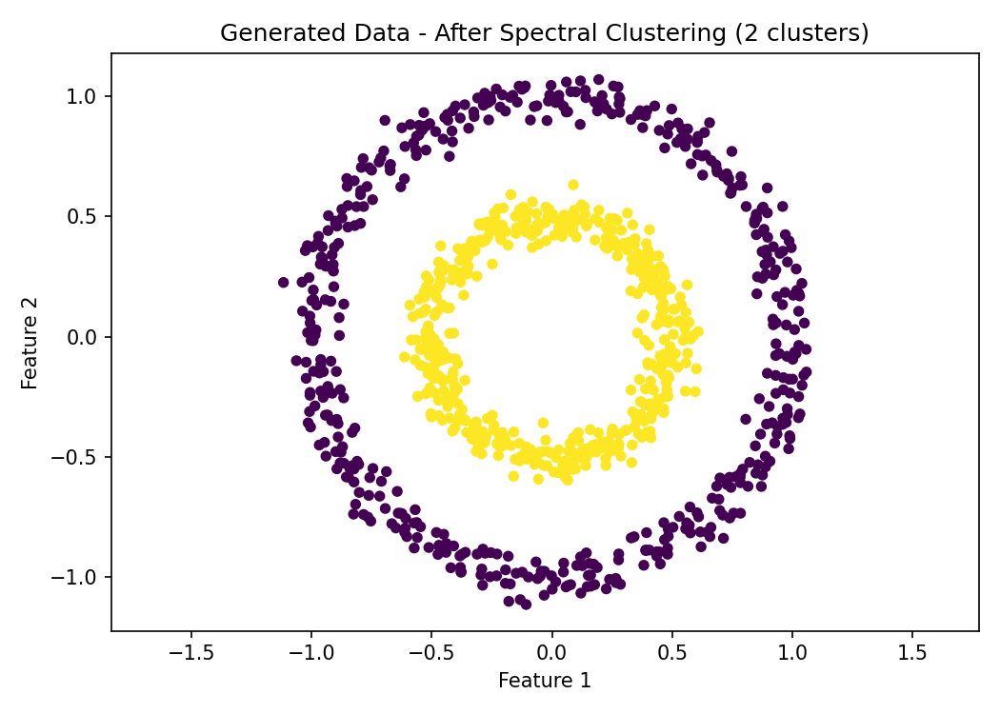
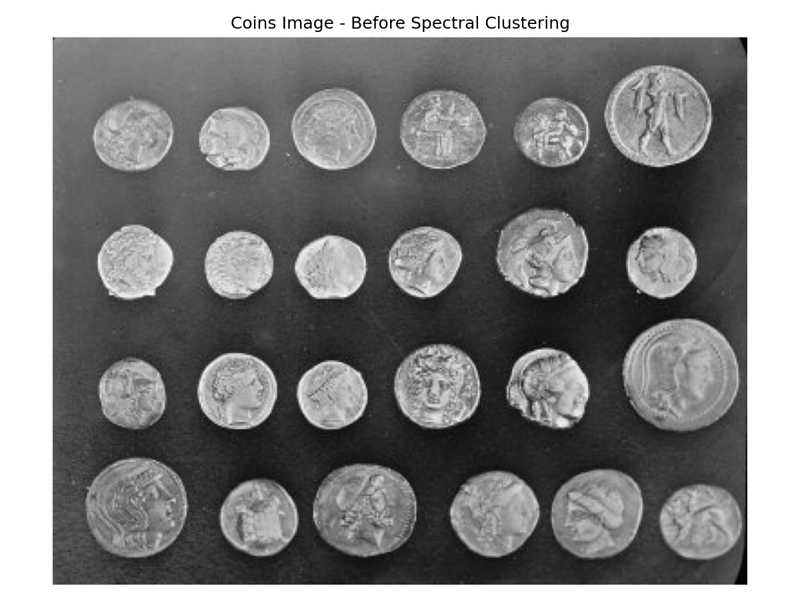
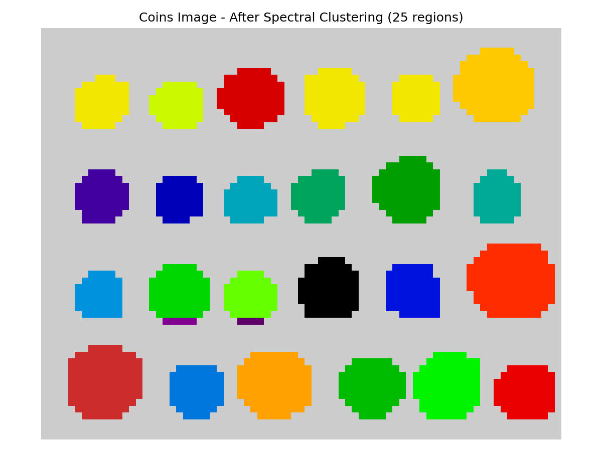

# BSCS4388-Lab2-Spectral-Clustering
Computer Vision Lab 2 - Spectral Clustering
# BSCS 4388 – Computer Vision
## Lab 2: Image Clustering – Spectral Clustering

### Overview
This lab applies Spectral Clustering to generated circular data and a real grayscale image using Python.

### Objectives
- Generate 1,000 samples arranged in two concentric circles using `make_circles`.
- Apply Spectral Clustering with two clusters.
- Visualize the data before and after clustering.
- Apply Spectral Clustering to the coins image using a pixel-neighborhood graph.
- Segment the image into 25 clusters.

### Technologies Used
- Python 3
- NumPy
- Matplotlib
- Scikit-learn
- Scikit-image

### Files
- `spectral_clustering.py` – Python implementation of Spectral Clustering.
- `spectral_data_before.png` – Generated data before clustering.
- `spectral_data_after.png` – Generated data after clustering.
- `spectral_image_before.png` – Coins image before clustering.
- `spectral_image_after.png` – Coins image after clustering.

### Installation
Install the required libraries:

```bash
pip install numpy matplotlib scikit-learn scikit-image
```

### How to Run
```bash
python spectral_clustering.py
```

### Results

#### 1. Generated Data — Before Spectral Clustering


#### 2. Generated Data — After Spectral Clustering


#### 3. Coins Image — Before Spectral Clustering


#### 4. Coins Image — After Spectral Clustering

